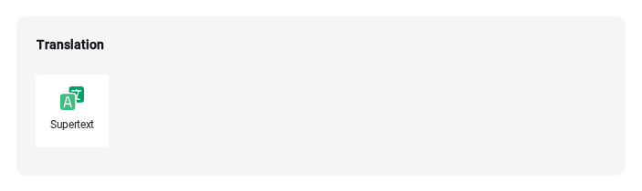
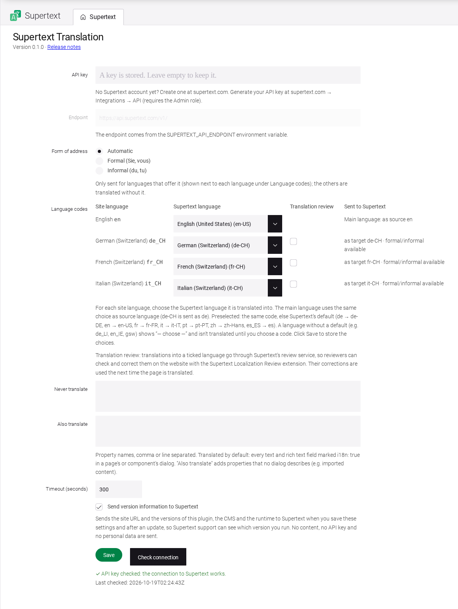
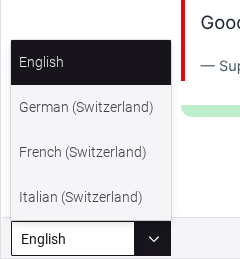

# Installation guide — Supertext Translation for Magnolia

For administrators who install and configure the module.

## Requirements

- Magnolia **6.4** (tested with 6.4.10 and 6.4.11 Community Edition; DX Core works the same way), which runs on Java 17 or 21 and a Jakarta servlet container such as Tomcat 11.
- The standard modules *Pages app* (`pages-app`) and *Site* (`site`). Every Magnolia bundle has them.
- A site with more than one language (see [Language setup](#language-setup)).
- A Supertext account with an API key for AI translation (see [API key](#api-key)).
- The Magnolia server must reach `https://api.supertext.com` over HTTPS.

## Install

The module is a single jar, `magnolia-supertext-translation-X.Y.Z.jar`, attached to every [GitHub release](https://github.com/Supertext/Magnolia-Supertext-Translation/releases). It needs no other libraries: everything it uses ships with Magnolia, and the [Supertext Java SDK](https://github.com/Supertext/Supertext-API-SDK-and-Guide) it talks to Supertext with is inside the jar (in its own package, so it doesn't clash with other software that uses the SDK).

**Maven webapp project** (the usual Magnolia setup): install the jar into your Maven repository and add it to the webapp's `pom.xml`:

```bash
mvn install:install-file -Dfile=magnolia-supertext-translation-0.1.0.jar \
  -DgroupId=com.supertext -DartifactId=magnolia-supertext-translation -Dversion=0.1.0 -Dpackaging=jar
```

```xml
<dependency>
  <groupId>com.supertext</groupId>
  <artifactId>magnolia-supertext-translation</artifactId>
  <version>0.1.0</version>
</dependency>
```

(Or build it from this repository: `mvn install` puts the same artifact, with the bundled Supertext SDK, into your local Maven repository.)

**Existing installation without a build:** copy the jar into the webapp's `WEB-INF/lib` folder (author instance; public instances don't need it).

Restart Magnolia. It installs the module like any other: automatically when `magnolia.update.auto=true`, otherwise open AdminCentral and confirm the installation screen. The log shows `Initializing module supertext-translation`.

After the installation:

- the Pages app has a **Translate with Supertext** action (page list and page editor);
- the app launcher has a **Supertext** app in the **Translation** group (superusers only).



## Update

Replace the jar (or raise the version in your `pom.xml`) and restart. Settings and translations are kept.

## Uninstall

Remove the jar (or the dependency) and restart. Translations stay in the pages. The settings and the latest API key check stay in the configuration (`config:/modules/supertext-translation`, nodes `config` and `state`); delete that node in the *Configuration* app if you want them gone. The ping route's configuration stays too: delete `config:/server/filters/servlets/SupertextPing` and the `supertextPing` entries under `config:/server/filters/{adminSetup,csrfTokenSecurity,uriSecurity,cache}/bypasses`.

## API key

Open the app launcher → **Translation** → **Supertext** (requires the `superuser` role).

Get a key first:

- No Supertext account yet? [Log in or create a Supertext account](https://www.supertext.com/person/en/account/signin) with your e-mail address.
- Generate the AI API key at [supertext.com → Integrations → API](https://www.supertext.com/en/integrations/api). This requires the **Admin** role in your Supertext account.

The Supertext app shows both links below the API key field.

1. Paste the API key. A key copied with its `Supertext-Auth-Key` prefix works too.
2. Click **Save**. The app stores the settings and then checks the key with Supertext (free of charge, Supertext's `features` call). Below the buttons it shows the result and when it was checked:

| Result | Message |
| --- | --- |
| ok | *API key checked: the connection to Supertext works.* |
| invalid | *Supertext rejected the API key. Check that you copied the whole key, or generate a new one at supertext.com → Integrations → API (requires the Admin role). No Supertext account yet? Create one at supertext.com.* |
| missing | *No API key is set yet. No Supertext account yet? Create one at supertext.com. Generate your API key at supertext.com → Integrations → API (requires the Admin role).* |
| unreachable | *The API key couldn't be checked because Supertext can't be reached. The settings are saved; check again later.* |
| error | *The API key couldn't be checked: Supertext answered with an error (HTTP …). The settings are saved; check again later.* |

**Check connection** runs the same check again with the saved key (or the one from `SUPERTEXT_API_KEY`); save a newly typed key first. An invalid key never blocks saving. The check also runs on its own when the key in the environment changed, and when Supertext rejects the key during a translation; the app then shows that result the next time it is opened.



The top of the app shows the installed **version**, linked to its release notes on GitHub; quote it when you contact support.

The key is stored in Magnolia's configuration (`config:/modules/supertext-translation/config`, property `apiKey`), which only superusers can read by default. It is never shown again: leave the field empty to keep it. For production, prefer the environment variable, which keeps the key out of the repository and its backups.

**Environment variables win** over the app (useful for containers). Java system properties with the same names work too.

| Variable | Meaning |
| --- | --- |
| `SUPERTEXT_API_KEY` | API key. The app then shows that the key comes from the environment and disables the field. |
| `SUPERTEXT_API_ENDPOINT` | API endpoint, default `https://api.supertext.com/v1/`. The endpoint field is then disabled. |
| `SUPERTEXT_VERSION_REPORTS` | `0` (or `false`, `off`, `no`) turns [version information](#version-information-and-the-api-key-check) off, `1` (`true`, `on`, `yes`) on, whatever the setting says. The checkbox is then disabled. |
| `SUPERTEXT_REPORT_URL` | For tests only: where version reports go instead of Supertext's Commando Center. |

## Language setup

Translations go from the site's **default language** into its other languages. Magnolia keeps every language of a page in the page itself: the default language under the field's name (`title`), the others with the locale appended (`title_de_CH`). The languages come from the site definition's `i18n` section, the same configuration the page editor's language selector uses:

```yaml
# <your-light-module>/sites/<site>.yaml (or the site definition in config:/modules/site/config/site)
i18n:
  class: info.magnolia.cms.i18n.DefaultI18nContentSupport
  enabled: true
  fallbackLocale: en        # the default (source) language
  locales:
    en:
      language: en
      enabled: true
    de_CH:
      language: de
      country: CH
      enabled: true
    fr_CH:
      language: fr
      country: CH
      enabled: true
```



Fields are translated when the page's or component's dialog marks them `i18n: true`, as Magnolia's multilingual authoring requires anyway:

```yaml
form:
  properties:
    title:
      $type: textField
      i18n: true
    text:
      $type: richTextField
      i18n: true
```

### Language codes

Each site language is sent to Supertext as a Supertext language code. Supertext accepts only its own codes: targets regional for German, English, French, Italian and Portuguese (`de-CH`, `de-DE`, `de-AT`, `en-US`, `en-GB`, `fr-CH`, `fr-FR`, `it-CH`, `it-IT`, `pt-BR`, `pt-PT`), with a script for Chinese and Serbian (`zh-Hans`, `zh-Hant`, `sr-Latn`, `sr-Cyrl`), Swiss German dialects (`gsw-u-sd-chzh`, `gsw-u-sd-chbe`) and bare for all others (`es`, `nl`, `sl`, `cs`, `ja`, …). The main (source) language is sent bare (`en`, `de`).

The module **doesn't guess**:

1. A line under **Language codes** in the Supertext app wins: `magnoliaLocale=supertextCode`, e.g. `de=de-CH`.
2. Otherwise a locale that already is a Supertext code is sent as it is (case and `_`/`-` don't matter): `de_CH` → `de-CH`, `fr_CH` → `fr-CH`, `es` → `es`.
3. Otherwise the language is **not supported**: nothing is sent for it and editors see *The language … has no Supertext language code*. A bare `de`, `fr`, `it`, `en` or `pt` always needs a line, because Supertext needs to know the region (`de=de-CH` or `de=de-DE`).

One line serves both directions: with `de=de-CH`, a site whose main language is `de` sends `de` as the source. The Supertext app lists every site language with the code it is sent as, whether the code comes from a line or is an exact match, and whether the language offers formal/informal; unsupported languages are marked red.

```text
de=de-CH
en=en-US
no=nb
```

### Interface languages

The module's own screens (the *Translate with Supertext* action and dialog, its messages and the Supertext app) are available in English, German, French and Italian. They follow each user's AdminCentral language: the user menu (top right) → **Edit profile** → **Language**, or for other users the Security app → **Users** → edit the user → **Language**. Other interface languages fall back to English. This is independent of the site's content languages above.

## Permissions

| Who | Can |
| --- | --- |
| Anyone who may edit the page (write permission on the `website` workspace, e.g. the `pages-app-editor` role) | Use **Translate with Supertext**. Translations are written with the editor's own rights, so Magnolia's access control applies. Magnolia has no per-language permissions: an editor of a page can translate it into every language of its site. |
| `superuser` | Open the Supertext app. To open it to other roles, decorate `supertext-translation:apps/supertext.yaml` (`permissions: roles`). |

## All settings

| Setting | Default | Meaning |
| --- | --- | --- |
| API key | – | See above. |
| Endpoint | `https://api.supertext.com/v1/` | Change only for testing. Must be `https` (plain `http` only to `localhost`), because the API key travels with every request. Disabled while `SUPERTEXT_API_ENDPOINT` is set. |
| Form of address | Automatic | *Formal* or *Informal* for languages that distinguish them (German *Sie*/*du*, French *vous*/*tu* …). Only sent for target languages that offer it (the language table's *Formal/informal* column): English, Romansh, Albanian, Serbian and Swiss German are translated without it. |
| Language codes | – | One `locale=code` per line (or separated by commas), e.g. `de=de-CH`. Needed for every site language that isn't a Supertext code already; see [Language codes](#language-codes). A line matches the locale apart from case and `_`/`-` (`de_CH` = `de-CH`); there is no fallback from `de_LI` to `de`. A code is sent as it is, even one the module doesn't know yet. |
| Never translate | – | Property names (comma or line separated) that keep the source text, e.g. `teaserCode`. |
| Also translate | – | Property names that are translated wherever they hold text, even if no dialog describes them (content from imports or legacy Magnolia 5 dialogs). Rich text is recognised by its tags. |
| Timeout (seconds) | 300 | How long to wait for Supertext per document before giving up (10–3600 s). |
| Send version information to Supertext | On | See [Version information and the API key check](#version-information-and-the-api-key-check). `SUPERTEXT_VERSION_REPORTS` wins. |

## Version information and the API key check

**Send version information to Supertext** is on by default: *Sends the site URL and the versions of this plugin, the CMS and the runtime to Supertext when you save these settings and after an update, so Supertext support can see which version you run. No content, no API key and no personal data are sent.*

A report goes to Supertext's Commando Center when you save the settings in the Supertext app, and when the module notices a new version of itself, Magnolia or Java (checked when the Supertext app is opened or a page is translated, never on website visits). It contains exactly:

- the site URL: Magnolia's `/server/defaultBaseUrl` (Configuration app → `server`), or the address AdminCentral was opened with while that is still a `localhost` address (Magnolia's default is `http://localhost:8080/magnolia/`); set `defaultBaseUrl` to the author instance's public address to be sure;
- the module's name (`Magnolia-Supertext-Translation`) and version, Magnolia's version, the Java version and the Supertext SDK version;
- whether an API key is set, and the result of the latest API key check (status, time, HTTP status, Supertext's error code);
- the address of the ping route below.

**No content, no API key and no personal data are sent.** Reports go from the Magnolia server, never from the browser, with a 3-second timeout; a failed report is not retried for an hour and never slows down or breaks a save or a translation. To turn it off, untick the setting and save, or set `SUPERTEXT_VERSION_REPORTS=0`: nothing is sent at all then, and the ping route answers 404. The API key check runs either way (see [API key](#api-key)). The module keeps the latest check and what it last reported in `config:/modules/supertext-translation/state` (a fingerprint of the key, never the key).

**The ping route** `GET <site URL>/.supertext/ping?challenge=…` lets Supertext see whether the installation is reachable from the internet. It needs no login, session or CSRF token and answers only `{"ok":true,"plugin":"Magnolia-Supertext-Translation","challenge":"…"}` with `Cache-Control: no-store`: no versions, no settings, no data. The module registers it at every start (servlet `SupertextPing` in `config:/server/filters/servlets`, and a `supertextPing` bypass in the `adminSetup`, `csrfTokenSecurity`, `uriSecurity` and, if present, `cache` filters), adding only what is missing. The Supertext app shows its address while reports are on. If a proxy or firewall in front of Magnolia only lets AdminCentral through, allow `/.supertext/ping` on the author instance as well.

## Troubleshooting

| Message or problem | What to do |
| --- | --- |
| *No Supertext API key configured* | Add the key in the Supertext app, or set `SUPERTEXT_API_KEY`. No account yet? Create one at [supertext.com](https://www.supertext.com/person/en/account/signin). Generate the key at [supertext.com → Integrations → API](https://www.supertext.com/en/integrations/api) (Admin role). |
| *Authentication failed. Please check the Supertext API key.* | The key is wrong or revoked. Paste it again, or generate a new one at [supertext.com → Integrations → API](https://www.supertext.com/en/integrations/api). |
| *This site has only one language* | Add languages to the site's `i18n` configuration (see Language setup). |
| *Too many requests to Supertext* | The module already retries rate limits 4 times; try again in a minute. |
| *Timed out waiting for the Supertext translation* | Very long pages (or with subpages): raise the timeout. |
| *Your Supertext translation limit is exceeded* | Contact Supertext about your plan. |
| *Could not reach Supertext* | The server can't connect to `api.supertext.com` (firewall, proxy). Magnolia uses the JVM's proxy settings (`https.proxyHost`, `https.proxyPort`). |
| *The language … has no Supertext language code* / a red line in the app's language table | The locale isn't a Supertext code (e.g. `de`, `en`, `de_LI`). Add a line under *Language codes*, e.g. `de=de-CH`; see [Language codes](#language-codes). Nothing was sent for that language. |
| *Supertext does not accept this language pair (source …, target …)* | A line under *Language codes* maps to a code Supertext doesn't offer (e.g. `es-ES` instead of `es`), or source and target are the same language. Fix the line; the message names the codes that were sent. |
| *Supertext doesn't offer the option politeness for …* | Formal/informal for a language that has none. The module doesn't send it for the languages it knows; for a code it doesn't know yet, set *Form of address* to *Automatic*. |
| *Supertext rejected the API key …* (after saving) | See [API key](#api-key): copy the whole key again or generate a new one at [supertext.com → Integrations → API](https://www.supertext.com/en/integrations/api) (Admin role). No account yet? Create one at [supertext.com](https://www.supertext.com/person/en/account/signin). |
| *The API key couldn't be checked because Supertext can't be reached* | The Magnolia server can't connect to `api.supertext.com` (firewall, proxy). The settings are saved; click **Check connection** later. |
| *The API key couldn't be checked: Supertext answered with an error (…)* | A temporary problem at Supertext, or a rate limit (HTTP 429). Click **Check connection** later. |
| `/.supertext/ping` asks for a login or returns a page | Another filter in front of the servlet filter; check that the `supertextPing` bypasses exist (see above) and that no proxy rewrites the path. With version reports off it answers 404 on purpose. |
| *Supertext’s answer was incomplete* | Texts were missing from the translated page; nothing was saved for that language. Translate again; if it keeps happening, send the page's content and the time to Supertext support. |
| No *Translate with Supertext* action | The user can't edit the page, the page is marked for deletion, or the module isn't installed (check the log). |
| A field stays in the source language | Its dialog doesn't mark it `i18n: true`, it's excluded under *Never translate*, or it's a field type that isn't translated (see the user guide). Add it under *Also translate* if it holds text. |

The module logs under `com.supertext.magnolia.translation` (warnings by default; Magnolia's default `log4j2.xml` sets `com` to `WARN`).
