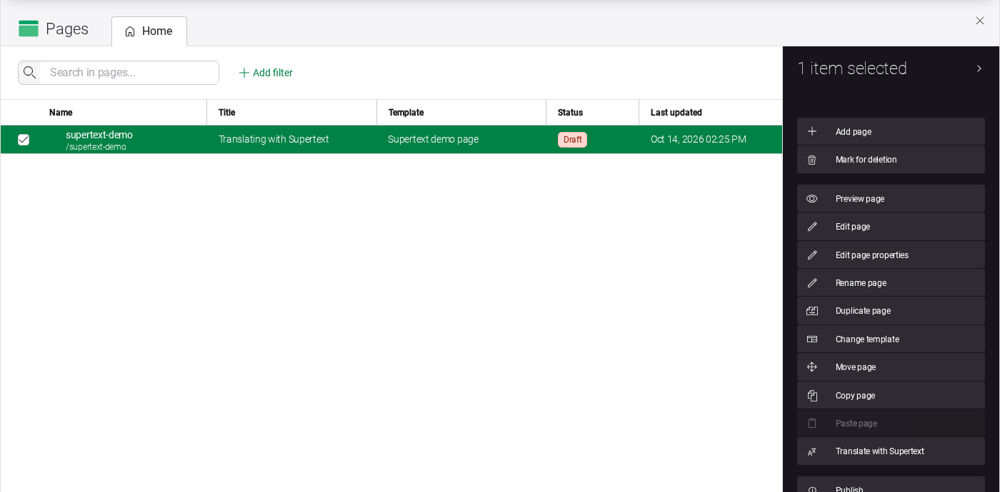
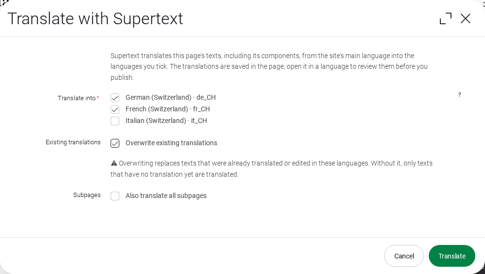
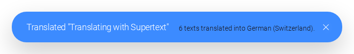
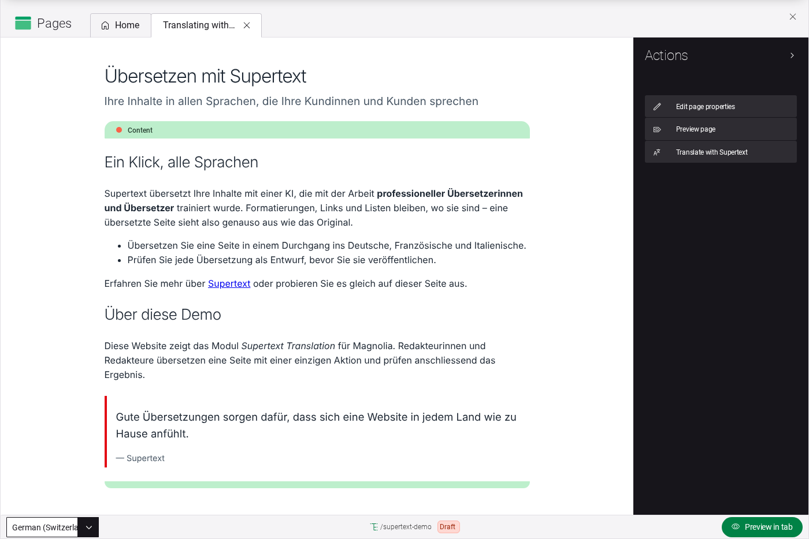
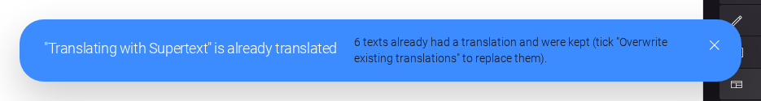

# User guide — Supertext Translation for Magnolia

For editors who translate pages. Your site has one main language (for example English) and some other languages (for example German, French and Italian). In Magnolia, all languages of a page live in the same page: the page editor's language selector switches between them.

## Translate a page

1. Open the **Pages** app and select the page. Click **Translate with Supertext** in the action bar (below *Paste page*). In the page editor, the same action is next to *Edit page properties* when the page itself is selected.

   

2. Tick the languages you want. Leave **Overwrite existing translations** unticked to translate only what has no translation yet, and tick **Also translate all subpages** to include the pages below it. Click **Translate**.

   

3. Supertext translates the page's title and texts and those of all its components, one language after the other. A message tells you how many texts were translated.

   

The translations are saved in the page right away, as for any change in Magnolia: the page shows as modified, and nothing changes on the public site until you publish.

## Review and publish

Open the page in the page editor and pick the language in the **language selector** at the bottom left. Check the texts and correct what you like in the usual dialogs (they show the language you picked). Then publish the page as usual.

## Translate again

Without **Overwrite existing translations**, texts that already have a translation in that language are kept, including your corrections; only texts without a translation (for example a new component) are translated. The message says how many were kept:

With **Overwrite existing translations**, every text is translated again from the main language and **replaces** what is in that language now, including changes you made by hand. The dialog warns about this below the checkbox.

## Export for translation and import a translated file

Instead of translating with Supertext's AI right away, you can download a page's texts as a file, have it translated elsewhere (by a translator, in a translation tool such as Trados, memoQ or Phrase, or in Supertext's web app) and import the translated file again. Both actions are in the Pages app next to **Translate with Supertext** (page list and page editor).

**Export:**

1. Select the page and click **Export for translation**.
2. Choose the **File format**:
   - **XLIFF 1.2 (for translation tools)**: the standard format of translation tools. Formatting appears as protected tags, so translators can't break it. One file can hold several languages. This is the better choice for translation tools and agencies.
   - **HTML (one language per file)**: a web page with the texts, for Supertext's web app or anyone who translates HTML. Tick exactly one language. Translators must leave the page's head (the `supertext:` lines) and the `data-st-id` attributes alone.
3. Tick the **Target languages** and click **Download file**. The file opens as a download in a new tab, for example `magnolia-<page id>-de_CH.xlf`. It holds the page's own texts and its components in the site's main language (not its subpages).
4. Send the file to your translator, or upload it to Supertext's web app.

**Import:**

1. Select any page and click **Import translation** (the file says which page and language it belongs to).
2. Choose the translated file (at most 10 MB). As when translating, existing translations are kept unless you tick **Overwrite existing translations**.
3. Click **Import translation**. The texts are written into the page's language, like a translation with Supertext; open the page in that language to review them before you publish.

The message shows, per page and language:

| Line | Meaning |
| --- | --- |
| *Imported: 12* | Texts written. |
| *Skipped, source changed since the export: 1* | The text in the main language was edited after the export, so the translation may be outdated. Tick **Also import texts whose source changed since the export** to import them anyway. |
| *Not translated in the file: 1* | The file has no translation for these texts (an empty target in XLIFF). |
| *Formatting changed, not imported: 1* | The translation broke or added formatting (tags, links). Fix it in the file and import again. |
| *Not in the file: 1* | Texts added to the page after the export. |
| *Kept, already translated: 1* | The language already had a translation there; tick **Overwrite existing translations** to replace it. |

An HTML file imported unchanged writes the source text back: HTML can't mark a text as untranslated, so import only files that were translated.

Errors with the whole file: *This file isn't a valid XLIFF or HTML translation file*; *This file wasn't exported by the Supertext module, or its header was removed* (the `supertext:` head lines or the XLIFF header are missing); *The file is too large (at most 10 MB)*; *This file belongs to another system (…)* (exported by another Supertext plugin); *The page this file was exported from no longer exists*; *The site has no language …*.

## What is translated

- Every text and rich text field of the page and its components that is set up as multilingual (`i18n`) in its dialog: titles, introductions, headlines, body texts, quotes, teasers …
- Fields inside composite fields (groups of fields), if they are multilingual.
- With **Also translate all subpages**: the same for every page below.

Formatting, links and lists in rich text stay where they are; links keep their target, only the link text is translated.

The form of address (formal or informal, e.g. *Sie* or *du*) your administrator chose is used for the languages that have one; English, for example, is translated without it.

**Not translated:** fields that aren't multilingual (they look the same in every language, like the quote's author in the demo), links, images and assets, dates, choices, tags and categories, the texts of assets in the Assets app, and fields your administrator excluded.

## Messages

The dialog, the messages and the Supertext app follow your AdminCentral interface language (English, German, French or Italian), which you set in your user profile.

| Message | Meaning |
| --- | --- |
| *6 texts translated into German (Switzerland).* | Done. Review and publish. |
| *… texts already had a translation and were kept* | Those texts were translated before (or edited). Tick *Overwrite existing translations* to replace them. |
| *Nothing to translate* | The page has no texts in the main language (or none that are multilingual). |
| *Italian (Switzerland): …* (in a message titled *with problems*) | That language failed; the others were saved. The reason follows, e.g. *Too many requests* (try again in a minute). |
| *Italian (Switzerland): Supertext’s answer was incomplete* | Supertext sent back the page with texts missing. Nothing was saved for that language, so no field is half translated. Try again. |
| *German (Liechtenstein): The language de_LI has no Supertext language code, so nothing was sent …* | Supertext needs an exact language code, and there is no obvious one for that language (Liechtenstein German, Irish English, Swiss German …). Nothing was sent for that language; the others were translated. Ask your administrator to choose one under *Language codes* in the Supertext app, then translate again. |
| *Supertext does not accept this language pair* | The language code set for that language isn’t one Supertext offers. Ask your administrator to check *Language codes* in the Supertext app. |
| *Supertext doesn’t offer the option politeness for …* | Formal/informal address isn’t available for that language. Ask your administrator to set *Form of address* to *Automatic*. |
| *No Supertext API key configured* / *Authentication failed* | Ask your administrator to check the Supertext app. The dialog stays open; nothing was changed. |
| *Translate into* is marked red | Pick at least one language. |
